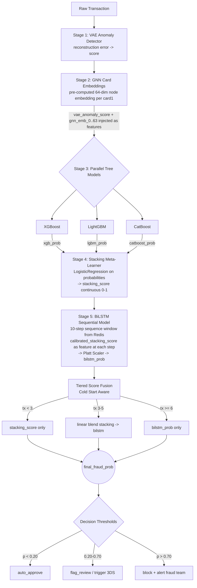
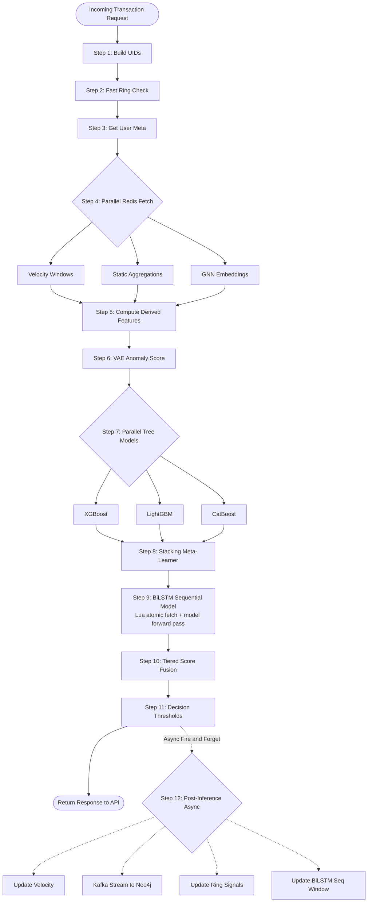

# Fraud Detection -- Real-Time Transaction Scoring System

A production-grade fraud detection system built on the IEEE-CIS / Vesta dataset. The system uses a multi-stage ensemble of gradient-boosted trees, deep learning models (VAE, BiLSTM, GNN), and a stacking meta-learner to score transactions in real time with approximately 8ms latency per transaction.

The pipeline covers the full lifecycle: offline training with K-fold cross-validation, full-dataset retraining after fold evaluation, real-time inference via a FastAPI service backed by Redis, asynchronous post-inference side-effects streamed through Kafka to a Neo4j graph database, a weekly automated retrain job with champion/shadow model deployment, and a confirmed-fraud label ingestion pipeline that closes the feedback loop.

---

## v2 training pipeline (tree ensemble)

The offline training path was rebuilt after an audit found the old one capped at ~0.61 AUC-PR by pipeline bugs:
- the data was split twice;
- a drift filter deleted the strongest columns;
- client statistics were computed from training rows only, so new clients got `-999`;
- string columns were silently dropped;
- class weighting was on everywhere;
- scores came from an average of stale fold models.

Run in order (all paths come from `configs/config.yaml`, sections `fe_v2` and `training_v2`):

```bash
python scripts/run_preprocessing.py          # one time split: train ≈ days 1-130, val ≈ 131-182, Kaggle test
python scripts/run_feature_engineering.py    # v2 features → data/processed/v2_<mode>/
python scripts/run_feature_selection.py      # time-consistency check → artifacts/v2/<mode>/dropped_features.json
python scripts/run_training.py               # time-fold CV → refit → val report (artifacts/v2/<mode>/metrics_val.json)
python scripts/run_training.py --final       # refit on train+val → Kaggle test predictions
```

Useful flags: `--agg-mode causal|transductive`, `--models lgbm`, `--fast` (higher learning rate, 1 seed), `--no-selection`.

What the v2 features do:

| Module | Practice |
|---|---|
| `base_features.py` | Every string column label-encoded; M4 fixed; only anchor-type D columns normalised (`day - D`); no absolute-time features |
| `client_features.py` | Client key `card1_addr1_(day-D1)` used only for grouping; per-client means, stds, distinct counts, 1h/1d/7d/30d velocity, deviation from the client's own past, lags, first-seen flags |
| `label_history.py` | Past fraud counts and smoothed rates per client, card, address and device, using only labels older than `label_delay_days` |
| `graph_features.py` | Shared-entity statistics (clients per device, devices per client, …) in place of the GNN classifier |
| `entity_ops.py` | Vectorised point-in-time primitives, tested against brute force and for zero future leakage (`tests/test_v2_pipeline.py`) |

`agg_mode: causal` uses only past rows and can be served in real time; this is the honest score. `transductive` aggregates over all rows, as in the Kaggle 1st-place solution; it is optimistic on a time holdout. The VAE, BiLSTM and GNN trainers and the legacy `pipeline.py` remain in `src/` but are not part of v2.

**Serving (v2):** `src/serving/` holds three pieces:
- an online feature engine that is parity-tested against the offline features;
- a decision service: allow/block lists → calibrated model → rules → cost-based policy, with reason codes and a decision log;
- a FastAPI app: `uvicorn src.serving.api_v2:app`.

**Feedback loop:** `src/feedback/` provides labels with maturity, a champion/challenger promotion gate, monitoring and exploration.

**Novelty layer:** `src/novelty/` replaces the old VAE.

The full run order and status are in `docs/IMPROVEMENT_PLAN.md`. The legacy `server.py` / `src/inference/` path is unchanged.

---

## Table of Contents

1. [Overall Architecture](#overall-architecture)
2. [Project Structure](#project-structure)
3. [Technology Stack](#technology-stack)
4. [Data Pipeline](#data-pipeline)
5. [Feature Engineering](#feature-engineering)
6. [Training Architecture](#training-architecture)
7. [Model Architectures](#model-architectures)
8. [Retraining on Full Dataset After Fold Evaluation](#retraining-on-full-dataset-after-fold-evaluation)
9. [Inference Architecture](#inference-architecture)
10. [Cold Start and Score Fusion](#cold-start-and-score-fusion)
11. [Post-Inference Pipeline](#post-inference-pipeline)
12. [Background Jobs](#background-jobs)
13. [Weekly Retrain with Shadow Deploy](#weekly-retrain-with-shadow-deploy)
14. [Fraud Label Feedback Loop](#fraud-label-feedback-loop)
15. [Database Schema](#database-schema)
16. [Redis Data Layout](#redis-data-layout)
17. [API Reference](#api-reference)
18. [Infrastructure and Deployment](#infrastructure-and-deployment)
19. [Version Control with Git and DVC](#version-control-with-git-and-dvc)
20. [Configuration Reference](#configuration-reference)
21. [Experiment Metrics and Results](#experiment-metrics-and-results)
22. [Testing](#testing)
23. [Setup and Installation](#setup-and-installation)
24. [Usage](#usage)
25. [Design Decisions and Trade-offs](#design-decisions-and-trade-offs)

---

## Overall Architecture

The system is a **5-stage sequential ensemble** where each stage feeds into the next. The final fraud score is a weighted fusion (not a simple vote) that adapts dynamically based on how much transaction history exists for a given user.



---

## Project Structure

```
fraud_detection/
|-- configs/
|   |-- config.yaml              # Master configuration (paths, Redis, Kafka, thresholds)
|   |-- features.yaml            # Feature subsets per model type
|
|-- src/
|   |-- preprocessing/
|   |   |-- sort_and_split.py    # Time-based sort and train/val split
|   |   |-- missing_values.py   # Model-specific NaN strategies
|   |   |-- v_column_reduction.py # V-column correlation + PCA
|   |   |-- build_cohort_priors.py # BiLSTM phantom padding priors
|   |
|   |-- feature_engineering/
|   |   |-- pipeline.py          # Full 13-step FE pipeline orchestrator
|   |   |-- uid_features.py      # UID construction (card1+addr1+email hash)
|   |   |-- frequency_encoding.py # Train-only frequency maps
|   |   |-- uid_aggregations.py  # Per-UID statistics (mean, std, count)
|   |   |-- amount_features.py   # Log-amount, decimal, z-score, ratios
|   |   |-- time_features.py     # Cyclic time encoding (sin/cos hour, dow)
|   |   |-- email_features.py    # Email domain matching, free provider flags
|   |   |-- device_features.py   # OS/browser/mobile encodings
|   |   |-- velocity_features.py # Offline batch velocity (gap, tx count)
|   |   |-- d_features.py        # D-column normalisation
|   |   |-- c_features.py        # C-column ratios and flags
|   |   |-- m_features.py        # M-column match/mismatch/NaN counts
|   |
|   |-- models/
|   |   |-- xgboost_model/       # XGBoost K-fold training + hyperparams
|   |   |-- lightgbm_model/      # LightGBM K-fold training
|   |   |-- catboost_model/      # CatBoost with native cat features
|   |   |-- vae/                 # Beta-VAE anomaly detector
|   |   |-- bilstm/              # Bidirectional LSTM with self-attention
|   |   |-- gnn/                 # Heterogeneous GraphSAGE (PyG)
|   |   |-- stacking/            # Logistic Regression meta-learner
|   |
|   |-- inference/
|   |   |-- predict.py           # FraudDetectionPredictor (single + batch)
|   |   |-- feature_store.py     # Redis-backed velocity + static features
|   |   |-- redis_atomic.py      # Lua-scripted atomic sequence window ops
|   |   |-- cold_start.py        # New-user initialisation + tier routing
|   |
|   |-- jobs/
|   |   |-- post_inference.py    # Async background tasks (5 concurrent)
|   |   |-- gnn_refresh.py       # Neo4j -> GraphSAGE -> Redis embedding loop
|   |   |-- fraud_label_consumer.py # Kafka consumer for confirmed fraud labels
|   |   |-- weekly_retrain_job.py   # Champion/shadow retrain pipeline
|   |
|   |-- db/
|   |   |-- schema.py            # SQLAlchemy ORM (training_transactions, model_versions)
|   |
|   |-- utils/
|       |-- logger.py            # Loguru configuration
|       |-- adversarial_validation.py # Train/test distribution shift detection
|       |-- forward_feature_selection.py # Greedy forward selection
|
|-- scripts/
|   |-- run_preprocessing.py     # Step 1: raw data -> processed splits
|   |-- run_feature_engineering.py # Step 2: feature engineering pipeline
|   |-- run_training.py          # Step 3: 7-stage model training
|   |-- run_inference.py         # Step 4: batch inference runner
|   |-- test_single_inference.py # End-to-end single transaction test
|   |-- test_fraud_feedback.py   # Fraud label ingestion test
|
|-- tests/
|   |-- test_features.py         # Feature engineering unit tests
|   |-- test_robustness.py       # Edge case and robustness tests
|
|-- notebooks/
|   |-- 01_baseline.ipynb        # Baseline LightGBM on raw features
|   |-- 02_feature_engineering.ipynb # Iterative FE with ablation
|   |-- 03_deep_learning.ipynb   # VAE, BiLSTM, GNN experiments
|   |-- 04_hyperparameter_tuning.ipynb # Optuna-based HP search
|   |-- 05_final_pipeline.ipynb  # End-to-end pipeline validation
|
|-- artifacts/
|   |-- checkpoints/             # Trained model files (DVC-tracked)
|   |-- metrics/                 # Experiment result JSONs (DVC-tracked)
|   |-- shap/                    # SHAP explanations (DVC-tracked)
|
|-- data/
|   |-- raw/                     # Raw IEEE-CIS CSVs (DVC-tracked)
|   |-- processed/               # Model-specific processed parquets (DVC-tracked)
|   |-- feature_store/           # Serialised feature artifacts (DVC-tracked)
|
|-- server.py                    # FastAPI application entry point
|-- docker-compose.yaml          # Redis + Kafka + Zookeeper + PostgreSQL
|-- requirements.txt             # Python dependencies
```

---

## Technology Stack

| Category       | Tools                                              |
| -------------- | -------------------------------------------------- |
| Tree Models    | XGBoost >= 2.0, LightGBM >= 4.0, CatBoost >= 1.2   |
| Deep Learning  | PyTorch >= 2.1, PyTorch Geometric >= 2.4           |
| Feature Store  | Redis >= 5.0 (with hiredis)                        |
| Streaming      | Apache Kafka (Confluent 7.5)                       |
| Graph Database | Neo4j (bolt protocol)                              |
| Relational DB  | PostgreSQL 15 (production), SQLite (local testing) |
| ORM            | SQLAlchemy >= 2.0                                  |
| API            | FastAPI with Uvicorn                               |
| Data           | pandas, numpy, scipy                               |
| Explainability | SHAP >= 0.43                                       |
| Logging        | Loguru                                             |
| Versioning     | Git + DVC (Data Version Control)                   |
| Containers     | Docker Compose                                     |

---

## Data Pipeline

The data pipeline runs in four sequential stages, each invoked by a separate script:

### Stage 1: Preprocessing (`scripts/run_preprocessing.py`)

1. **Load raw data** -- Reads `train_transaction.csv`, `train_identity.csv`, `test_transaction.csv`, `test_identity.csv` from `data/raw/` and merges transaction + identity tables on `TransactionID`.
2. **Time-based sort** -- All rows sorted by `TransactionDT` (seconds since an arbitrary reference). This is critical because the dataset represents temporal financial data; random shuffling would cause data leakage.
3. **Time-based split** -- The first 75% of the `TransactionDT` range becomes the training set; the remaining 25% becomes the validation set (configured via `split.train_quantile` in `config.yaml`).
4. **V-column reduction** -- The 339 V-columns are grouped by their NaN pattern, then within each group, columns with Pearson correlation > 0.9 are deduplicated. This typically reduces V-columns from 339 to approximately 100-120.
5. **Cohort prior computation** -- Compute per-cohort (DeviceType x P_emaildomain x ProductCD) mean feature values and fraud rates. These are saved as `cohort_priors.json` and used at inference time to pad the BiLSTM sequence window for new users.

### Stage 2: Feature Engineering (`scripts/run_feature_engineering.py`)

The feature engineering pipeline (`src/feature_engineering/pipeline.py`) runs 13 sequential steps. Details are in the [Feature Engineering](#feature-engineering) section below.

### Stage 3: Training (`scripts/run_training.py`)

The 7-stage training pipeline. Details are in the [Training Architecture](#training-architecture) section below.

### Stage 4: Inference (`scripts/run_inference.py`)

Batch or single-transaction inference using the trained models. Details are in the [Inference Architecture](#inference-architecture) section below.

---

## Feature Engineering

The feature engineering pipeline transforms raw IEEE-CIS columns into model-ready features through 13 ordered steps. Every step is designed to prevent data leakage -- encoders are fit on the training split only, then applied to validation and test.

### Step-by-Step Feature Engineering

| Step | Module                                    | Description                                                                                                                                                                            |
| ---- | ----------------------------------------- | -------------------------------------------------------------------------------------------------------------------------------------------------------------------------------------- |
| 0    | `sort_and_split.py`                       | Sort by `TransactionDT`, split train/val at 75th percentile                                                                                                                            |
| 1    | `uid_features.py`                         | Construct user identities: `uid1 = hash(card1, addr1, P_emaildomain)`, `uid_magic = hash(card1, addr1, D1)`                                                                            |
| 2    | `missing_values.py`                       | Encode M-columns: T=1, F=0, NaN=-1 (trees) or NaN=0 (VAE)                                                                                                                              |
| 3    | `time_features.py`                        | Cyclic encoding: `hour_sin`, `hour_cos`, `dow_sin`, `dow_cos`, `month_sin`, `month_cos`, `is_weekend`, `is_late_night`                                                                 |
| 4    | `d_features.py`                           | Normalise D-columns: `D_norm = D - D.mean_by_day` for D1, D2, D3, D4, D5, D10, D11, D15                                                                                                |
| 5    | `email_features.py`, `device_features.py` | `email_match`, `P_email_is_free`, `email_trusted`, TLD extraction, `device_os_encoded`, `device_browser_encoded`, `device_mobile`                                                      |
| 6    | `frequency_encoding.py`                   | Frequency encoding (train-only fit) for 16 categorical columns: card1-6, addr1-2, email domains, DeviceInfo, uid1, uid_magic, id_20, id_31                                             |
| 7    | `uid_aggregations.py`                     | Per-UID statistics computed on training data: `uid_amt_mean`, `uid_amt_std`, `uid_amt_max`, `uid_amt_min`, `uid_tx_count`, and analogous for card1, addr1, email                       |
| 8    | `amount_features.py`                      | `TransactionAmt_log`, `TransactionAmt_decimal`, `amt_over_uid_mean`, `amt_over_uid_max`, `amt_over_card1_mean`, `amt_zscore`                                                           |
| 9    | `c_features.py`                           | C-column ratios: `C1_C2_ratio`, `C5_C6_ratio`, `C6_C11_ratio`, `C3_flag`                                                                                                               |
| 10   | `m_features.py`                           | M-column aggregates: `M_match_count`, `M_mismatch_count`, `M_nan_count`                                                                                                                |
| 11   | `velocity_features.py`                    | Offline velocity (using `uid1` groups): `uid_tx_1h`, `uid_tx_24h`, `uid_total_amt_24h`, `uid_gap_last`, `uid_avg_gap`                                                                  |
| 12   | `v_column_reduction.py`                   | Group V-columns by NaN pattern, drop correlated pairs (r > 0.9), fit PCA within each group (3 components per group for DL models), add `uid x V` aggregations for top-8 SHAP V-columns |
| 13   | `missing_values.py`                       | Model-specific NaN fills: trees get -999, CatBoost gets "missing" string for categoricals, VAE gets median imputation                                                                  |

### Model-Specific Feature Sets

The same raw features are prepared differently for each model type:

**Tree Models (XGBoost, LightGBM):**

- All engineered features (including velocity)
- NaN filled with -999
- Frequency-encoded categoricals
- VAE anomaly score (injected after Stage 1 training)
- 64-dim GNN card embeddings (injected after Stage 2 training)

**CatBoost:**

- Same as tree models, except 5 columns (`card4`, `card6`, `ProductCD`, `DeviceType`, `P_emaildomain`) are passed as native categorical strings (not frequency-encoded)

**VAE:**

- Numerical features only (no velocity, no uid_magic)
- Median-imputed NaNs (not -999)
- M-columns: NaN=0 (not -1)
- PCA-reduced V-columns
- Excludes: `uid_tx_1h`, `uid_tx_24h`, `uid_total_amt_24h`, `uid_gap_last`, `uid_avg_gap`

**BiLSTM:**

- 12 raw features + `calibrated_stacking_score` = 13 features per timestep
- Sequence length: 10 timesteps (sorted by TransactionDT within each UID)
- Step features: `TransactionAmt_log`, `amt_zscore`, `uid_gap_last`, `hour_sin`, `hour_cos`, `is_late_night`, `uid_tx_1h`, `uid_total_amt_24h`, `D1_norm`, `device_mobile`, `ProductCD_encoded`, `M_match_count`

**Stacking Meta-Learner:**

- Input: `[xgb_prob, lgbm_prob, catboost_prob]` -- 3 values only

---

## Training Architecture

Training is orchestrated by `scripts/run_training.py` and proceeds through 7 sequential stages. Each stage depends on outputs from the previous stage.

```
Stage 1          Stage 2          Stage 3,4,5          Stage 6          Stage 7
 VAE    ------>   GNN    ------>  XGB/LGBM/CB  ------> Stacking ------> BiLSTM
 (anomaly       (card            (tree models          (meta-           (sequential
  scores)       embeddings)       with VAE+GNN)        learner)         model with
                                                                        stacking
                                                                        score as
                                                                        feature)
```

### Stage 1: VAE (Variational Autoencoder)

- **Purpose**: Unsupervised anomaly detector. Trained on legitimate transactions only; fraudulent transactions produce high reconstruction error.
- **Input**: Numerical feature subset (median-imputed, no velocity)
- **Output**: `vae_anomaly_score` (normalised 0-1) -- injected as a **feature** into tree models
- **Training**: Full training set (not K-fold). Uses beta-VAE loss = MSE reconstruction + beta \* KL divergence.

### Stage 2: GNN (Graph Neural Network)

- **Purpose**: Learn card-level relationships in a heterogeneous transaction graph.
- **Model**: `HeteroSAGE` -- 2-layer GraphSAGE converted via `to_hetero()` for heterogeneous data.
- **Graph structure**: 5 node types (transaction, card, addr, email, device) with 8 edge types (4 forward + 4 reverse).
- **Output**: 64-dimensional card embedding per `card1` value -- injected as 64 features (`gnn_emb_0` through `gnn_emb_63`) into tree models.
- **Note**: GNN does NOT run at inference time. Embeddings are pre-computed offline and served from Redis/disk.

### Stage 3: XGBoost

- **Training**: 5-fold time-aware cross-validation. Out-of-fold (OOF) predictions on training data and predictions on validation data are saved.
- **Hyperparameters**: Optuna-tuned. Key settings: `n_estimators=5000`, `max_depth=7`, `learning_rate=0.0335`, `colsample_bytree=0.40`, `eval_metric=aucpr`, early stopping at 200 rounds.
- **Features**: Full feature set including `vae_anomaly_score` + 64 GNN embedding dimensions.
- **Output**: `xgb_prob` per sample (fold-averaged).

### Stage 4: LightGBM

- Parallel to XGBoost. Same 5-fold CV, same feature set.
- **Output**: `lgbm_prob` per sample (fold-averaged).

### Stage 5: CatBoost

- Same fold structure. Uses native categorical handling for 5 columns.
- **Output**: `catboost_prob` per sample (fold-averaged).

### Stage 6: Stacking Meta-Learner

- **Model**: `LogisticRegression(C=1.0)` with `StandardScaler`.
- **Input**: `[xgb_prob, lgbm_prob, catboost_prob]` -- OOF predictions from Stages 3-5.
- **Output**: `stacking_score` -- a continuous probability [0, 1].
- **Design note**: The meta-learner is intentionally NOT calibrated (no isotonic calibration). Calibration would bin probabilities into flat step-wise blocks, destroying the gradient signal that the BiLSTM needs in Stage 7.

### Stage 7: BiLSTM Sequential Meta-Learner

- **Model**: 2-layer bidirectional LSTM with self-attention.
- **Input**: Sequences of 10 timesteps, each with 13 features. Feature #13 at every timestep is `calibrated_stacking_score` (OOF predictions during training, live stacking score at inference).
- **Sequence construction**: Transactions sorted by `(TransactionDT, TransactionID)` within each UID group. Short sequences are padded with cohort-average priors (NOT zeros).
- **Loss**: Focal Loss (gamma=2.0, alpha=0.25) -- handles severe class imbalance without SMOTE.
- **Output**: `bilstm_prob` -- after Platt scaling for calibration.

### Train/Serve Skew Prevention

The following measures ensure that the model behaves identically in training and production:

1. **Cohort padding** -- BiLSTM sequences shorter than 10 steps are padded with cohort-average priors. The same values are stored in `cohort_priors.json` and loaded into Redis at service startup.
2. **Sort guarantee** -- Sequences sorted by `(TransactionDT, TransactionID)` in training. At inference, Redis RPUSH preserves chronological order.
3. **Stacking score in BiLSTM** -- During training, the BiLSTM receives OOF stacking predictions (not validation predictions, which would cause leakage). At inference, it receives the live stacking score.
4. **Redis updated AFTER decision** -- Velocity features (tx counts, amounts) are updated in Redis only after the fraud score is returned, preventing the current transaction from leaking into its own velocity window.

---

## Model Architectures

### FraudVAE (Variational Autoencoder)

```
Encoder:  Linear(input_dim, 80) -> Mish -> BN -> Linear(80, 40) -> Mish -> BN
          -> mu_layer(40, 16), logvar_layer(40, 16)

Latent:   z = mu + eps * exp(0.5 * logvar)   (reparameterisation trick)
          Deterministic at inference (z = mu)

Decoder:  Linear(16, 40) -> Mish -> BN -> Linear(40, 80) -> Mish -> BN -> Linear(80, input_dim)

Loss:     MSE reconstruction + beta * KL divergence
          logvar clamped to [-10, 10] to prevent float32 overflow

Anomaly:  Per-sample reconstruction MSE (mean over feature dim)
```

- Activation: Mish (`x * tanh(softplus(x))`) throughout -- better gradient flow than ReLU.
- Latent dimension: 16.
- Beta: 1.0 (standard VAE, not aggressively disentangled).

### FraudBiLSTM (Bidirectional LSTM with Self-Attention)

```
Input:    (batch, seq_len=10, n_features=13)

LSTM:     2-layer BiLSTM, hidden_size=128 per direction
          -> output: (batch, seq_len, 256)

Dropout:  0.3

Attention: Soft self-attention over sequence dimension
           scores = Linear(256, 1)  ->  softmax  ->  weighted sum
           -> context: (batch, 256)

Dropout:  0.3

Classifier: Linear(256, 64) -> Mish -> Dropout(0.2) -> Linear(64, 1)
            -> logits: (batch,)

Loss:     FocalLoss(gamma=2.0, alpha=0.25)
```

- Total output dimension: 128 \* 2 = 256 (bidirectional).
- Self-attention learns which timesteps are most informative.
- Focal Loss down-weights easy negatives, focusing on hard examples.

### HeteroSAGE (Heterogeneous Graph Neural Network)

```
Input Projection:  Per-node-type Linear(in_dim, 128) -> Mish -> LayerNorm

GraphSAGE Layer 1: SAGEConv(128, 128, aggr="mean") -> Mish -> LayerNorm -> Dropout(0.1)
GraphSAGE Layer 2: SAGEConv(128, 64, aggr="mean")  -> LayerNorm

Classifier:        Linear(64, 32) -> Mish -> Dropout(0.1) -> Linear(32, 1)
                   -> per-transaction fraud logit

Embedding output:  get_embeddings() returns {node_type: (n_nodes, 64)} dict
```

- **Node types**: transaction, card, addr, email, device.
- **Edge types**: uses_card, from_addr, uses_email, uses_device (+ 4 reverse edges).
- The `to_hetero()` wrapper replicates the homogeneous GraphSAGE for every edge type.
- Card embeddings (64-dim) are the primary output used downstream by tree models.

### Stacking Meta-Learner

```
StandardScaler -> LogisticRegression(C=1.0, solver='lbfgs', max_iter=1000)
Input:  [xgb_prob, lgbm_prob, catboost_prob]  (3 features)
Output: stacking_score (continuous 0-1)
```

---

## Retraining on Full Dataset After Fold Evaluation

After the K-fold cross-validation phase establishes model quality and produces OOF predictions for the stacking meta-learner, the system supports a **full retrain mode** that trains on the entire dataset (train + validation combined) to maximise model capacity for production deployment.

### How It Works

The full retrain is triggered by the `--retrain-full` flag:

```bash
python scripts/run_training.py --retrain-full
```

### Full Retrain Procedure

1. **Data concatenation**: The training and validation parquets are concatenated for each model type (tree, catboost, bilstm, vae). There is no held-out validation set in this mode.

2. **VAE**: Retrained on the combined legitimate-only data. Anomaly scores are computed for the full combined set.

3. **GNN**: Retrained on the combined data with `use_cv=False`. Card embeddings are regenerated and injected into the tree training data.

4. **Tree models (XGBoost, LightGBM, CatBoost)**: Each is trained with `use_cv=False`, meaning no K-fold CV. Instead, they train on the full combined data using a fixed number of iterations (no early stopping, since there is no validation set to monitor).
   - XGBoost uses `XGB_FINAL_N_ESTIMATORS = 5500` (110% of the average best iteration across the 5 folds, to account for the extra data).
   - Models are saved as `xgb_final.pkl`, `lgbm_final.pkl`, `catboost_final.cbm`.

5. **Stacking meta-learner**: The existing CV-trained meta-learner is loaded (NOT retrained). It uses the full-data predictions from the final tree models to generate stacking scores. This preserves the meta-learner's calibration from the CV phase.

6. **BiLSTM**: Retrained on the full combined data with the stacking scores from step 5 injected as `calibrated_stacking_score`. Saved as `bilstm_final.pt`.

### Why This Design

- **K-fold CV first**: Produces OOF predictions needed for the stacking meta-learner and BiLSTM training. Also provides reliable performance metrics.
- **Full retrain second**: Uses all available data for the production model, since the CV phase already validated model quality.
- **Meta-learner not retrained**: The meta-learner learned its weights from OOF predictions during CV. Retraining it on full-data predictions (which are NOT out-of-fold) would cause overfitting.

### Production Model Loading

The `FraudDetectionPredictor.load_all()` method automatically detects whether full-retrain models exist:

- If `xgb_final.pkl` exists, it loads a single model (not fold models).
- If `bilstm_final.pt` exists, it loads that instead of `bilstm_best.pt`.
- Fold models are the fallback if no `*_final.*` files are found.

---

## Inference Architecture

The real-time inference engine is implemented in `src/inference/predict.py` as the `FraudDetectionPredictor` class. It loads all models once at startup and predicts individual transactions or batches.



### 12-Step Single Transaction Pipeline (`predict_single`)

| Step | Action                                                                | Latency     |
| ---- | --------------------------------------------------------------------- | ----------- |
| 1    | Build UIDs: `uid1 = hash(card1 + addr1 + email)`                      | <0.1ms      |
| 2    | Ring check: `fast_ring_check()` via Redis SETs                        | ~1ms        |
| 3    | Get user meta from Redis: `tx_count_so_far`, `is_new_user`            | ~1ms        |
| 4    | Parallel Redis fetch (3 threads): velocity, static agg, GNN embedding | ~2ms        |
| 5    | Compute derived features: time, email, device, freq encoding          | ~1ms        |
| 6    | VAE anomaly score: forward pass through FraudVAE                      | ~0.5ms      |
| 7    | Parallel tree models (3 threads): XGB, LGBM, CatBoost                 | ~2ms        |
| 8    | Stacking meta-learner: LR on [xgb_prob, lgbm_prob, cb_prob]           | <0.1ms      |
| 9    | BiLSTM: Lua atomic push+trim+read from Redis, forward pass            | ~1ms        |
| 10   | Score fusion: `_get_final_score(stacking, bilstm, tx_count)`          | <0.1ms      |
| 11   | Decision thresholds: auto_approve / flag_review / block               | <0.1ms      |
| 12   | Post-inference async: velocity update, Kafka, ring, seq window        | 0ms (async) |

**Total target latency: approximately 8ms per transaction.**

### Vectorised Batch Prediction (`predict_batch`)

For batch scoring, the system optimises by:

- **Redis**: One fetch per unique UID (not one per row).
- **Tree models**: Single `predict_proba` call on the full (N, n_features) matrix.
- **VAE**: Single batched torch forward pass.
- **Stacking**: Fully vectorised.
- **BiLSTM**: Sequential per row (sequence depends on history order -- cannot be parallelised).
- **Ring check**: Deduplicated per (device, email) pair within the batch.

### Parallelisation Strategy

The predictor uses `ThreadPoolExecutor` in two places:

1. **Redis fetch phase (3 workers)**: Velocity features, static aggregation features, and GNN card embeddings are fetched concurrently.
2. **Tree model phase (3 workers)**: XGBoost, LightGBM, and CatBoost predictions run concurrently.

---

## Cold Start and Score Fusion

This is the most important design decision in the pipeline. New users have no transaction history, so the BiLSTM sequence model cannot make reliable predictions. The fusion logic handles this gracefully:

### Tiered Fusion Weights

| User State | tx_count | Fusion Rule                                                          | Reason                                                 |
| ---------- | -------- | -------------------------------------------------------------------- | ------------------------------------------------------ |
| Cold       | < 3      | `final = stacking_score`                                             | No sequence history; BiLSTM unreliable                 |
| Warm       | 3-5      | `final = (1-alpha)*stacking + alpha*bilstm` where alpha ramps 0 to 1 | Building history; linear transition                    |
| Full       | >= 6     | `final = bilstm_prob`                                                | Rich history; stacking already baked into BiLSTM input |

### Why Not a Weighted Average

The BiLSTM receives `calibrated_stacking_score` as an input feature at every timestep. If the final score were computed as `w*stacking + (1-w)*bilstm`, it would double-count the stacking signal (once as a BiLSTM input, once in the fusion). The tiered transition avoids this compounding artifact.

### Cold Start Initialisation

When a new user is encountered:

1. `ColdStartHandler.initialize_new_user()` populates Redis with cohort-average priors (based on DeviceType x P_emaildomain x ProductCD).
2. The BiLSTM sequence window is pre-filled with phantom cohort-average vectors (not zeros), matching the padding used during training.
3. `is_new_user=1` and `tx_count_so_far=0` are injected as features into the tree models, allowing them to apply elevated base risk.

---

## Post-Inference Pipeline

After the fraud score is returned to the caller, five background tasks run asynchronously via a `ThreadPoolExecutor(max_workers=8)`:

| Task | Description                                                       | Target                                      |
| ---- | ----------------------------------------------------------------- | ------------------------------------------- |
| A    | Update velocity counters in Redis sorted sets                     | `uid:{uid}:txn_times`, `uid:{uid}:txn_amts` |
| B    | Stream transaction to Kafka `graph-updates` topic (Neo4j sink)    | Kafka                                       |
| C    | Update ring signals -- run `fast_ring_check()` and persist result | Redis `ring:device:*`, `ring:email:*`       |
| D    | Update BiLSTM sequence window (safety net for batch callers)      | Redis `user:{uid}:seq_window`               |
| E    | Increment user transaction count                                  | Redis `user:{uid}:features`                 |

These tasks add zero latency to the checkout path. The function `post_inference_async()` returns in <1ms.

---

## Background Jobs

### Job 1: GNN Embedding Refresh (`src/jobs/gnn_refresh.py`)

A daemon thread (or standalone process) that periodically refreshes card embeddings:

1. **Pull**: Execute a Cypher query against Neo4j to get the last 24 hours of Card-Device-Email-Address edges.
2. **Build**: Construct a PyG `HeteroData` graph from the pulled transactions.
3. **Infer**: Run a full-graph forward pass through the trained `HeteroSAGE` model to extract 64-dim embeddings for every card node.
4. **Write**: Pipeline-write all card embeddings to Redis under `gnn:{card_id}` keys with a 30-minute TTL.

Default interval: 60 seconds. This fills the staleness gap between the pre-computed embeddings and live transaction patterns.

### Job 2: Post-Inference Kafka Streaming (`src/jobs/post_inference.py`)

Every scored transaction is published to the `graph-updates` Kafka topic. A Neo4j Kafka connector sinks this topic, creating/updating `(:Card)-[:USED_ON]->(:Device)` relationships in the graph database. This keeps the graph current for the next GNN refresh cycle.

### Job 3: Fraud Label Consumer (`src/jobs/fraud_label_consumer.py`)

A Kafka consumer that reads from the `confirmed_fraud_labels` topic and writes confirmed fraud labels to the PostgreSQL `training_transactions` table. The consumer:

- Uses manual offset commit (commit only after successful DB write).
- Validates message schema (requires `transaction_id` and `is_fraud`).
- Handles graceful shutdown via SIGTERM/SIGINT.
- Batch-processes messages for throughput.

### Job 4: Weekly Retrain (`src/jobs/weekly_retrain_job.py`)

Detailed in the [Weekly Retrain with Shadow Deploy](#weekly-retrain-with-shadow-deploy) section.

---

## Weekly Retrain with Shadow Deploy

The weekly retrain job automates the model update lifecycle with a champion/shadow deployment strategy.

### Retrain Flow

```
1. Load new labels       2. Retrain XGB +       3. Shadow comparison     4. Promote or
   from DB (since           stacking in temp       (champion vs shadow      discard
   last retrain)            directory               on val split)
       |                        |                       |                      |
   >= 500 labels?          Time-aware split         shadow_aupr >          Copy shadow
   No -> skip              (80/20 on combined)      champion_aupr +        artifacts to
                                                    0.003?                 champion dir
                                                    No -> log + discard    + update DB
```

### Configuration Constants

| Parameter            | Value | Description                                         |
| -------------------- | ----- | --------------------------------------------------- |
| `MIN_NEW_LABELS`     | 500   | Skip retrain if fewer new confirmed labels          |
| `PROMOTE_THRESHOLD`  | 0.003 | Shadow must beat champion AUC-PR by this margin     |
| `SHADOW_WINDOW_DAYS` | 2     | Shadow observation period before promotion decision |
| `NO_IMPROVE_MAX`     | 4     | Retire champion after 4 consecutive failed promotes |

### Running the Retrain Job

```bash
# Production run
python -m src.jobs.weekly_retrain_job --config configs/config.yaml --lookback-days 7

# Dry run (no DB writes, no file overwrites)
python -m src.jobs.weekly_retrain_job --dry-run
```

---

## Fraud Label Feedback Loop

The system implements a complete feedback loop for confirmed fraud labels:

```
Transaction scored ----> training_transactions table (with score + decision)
                              |
                              |  (days/weeks later)
                              v
Chargeback / manual review ----> Kafka 'confirmed_fraud_labels' topic
                              |
                              v
                         fraud_label_consumer.py
                              |
                              v
                         UPDATE training_transactions SET confirmed_fraud = 1
                              |
                              v
                         weekly_retrain_job.py queries:
                         WHERE confirmed_fraud IS NOT NULL
                         AND labelled_at > last_retrain_at
```

---

## Database Schema

Two SQLAlchemy ORM tables in PostgreSQL (or SQLite for local testing):

### Table: `training_transactions`

Stores every scored transaction. One row per transaction, populated by two sources:

- `predict_single()` / `predict_batch()` writes immediately after scoring.
- `fraud_label_consumer.py` fills `confirmed_fraud` when a label arrives.

| Column                           | Type                         | Description                              |
| -------------------------------- | ---------------------------- | ---------------------------------------- |
| `id`                             | BigInteger PK                | Auto-increment                           |
| `transaction_id`                 | String(64)                   | Unique transaction ID (indexed)          |
| `uid`                            | String(128)                  | User identifier (indexed)                |
| `transaction_dt`                 | Integer                      | Seconds since epoch                      |
| `transaction_amt`                | Float                        | Transaction amount                       |
| `card1`, `card4`, `card6`        | String                       | Card identifiers                         |
| `device_info`, `device_type`     | String                       | Device metadata                          |
| `p_emaildomain`, `r_emaildomain` | String                       | Email domains                            |
| `final_fraud_score`              | Float                        | Final calibrated fraud probability       |
| `stacking_score`                 | Float                        | Intermediate stacking output             |
| `bilstm_prob`                    | Float                        | BiLSTM sequential score                  |
| `decision`                       | String(20)                   | `auto_approve` / `flag_review` / `block` |
| `confirmed_fraud`                | Integer (nullable)           | NULL=unlabelled, 1=fraud, 0=legitimate   |
| `label_source`                   | String(64)                   | `chargeback`, `manual_review`, `auto`    |
| `labelled_at`                    | DateTime (nullable, indexed) | When the label was confirmed             |

### Table: `model_versions`

Audit log of every trained model checkpoint. Tracks the champion/shadow lifecycle:

| Column            | Type        | Description                                |
| ----------------- | ----------- | ------------------------------------------ |
| `version_tag`     | String(64)  | e.g. `v20240701_001`                       |
| `model_type`      | String(32)  | `xgb`, `bilstm`, `full_stack`              |
| `checkpoint_path` | String(512) | Path to artifacts directory                |
| `n_new_labels`    | Integer     | Confirmed labels used in this training run |
| `val_auc_roc`     | Float       | Validation AUC-ROC                         |
| `val_auc_pr`      | Float       | Validation AUC-PR                          |
| `is_shadow`       | Boolean     | Currently in shadow evaluation             |
| `is_champion`     | Boolean     | Currently serving production traffic       |
| `is_retired`      | Boolean     | Replaced by a newer champion               |
| `promoted_at`     | DateTime    | When promoted from shadow to champion      |
| `mlflow_run_id`   | String(64)  | Optional MLflow reference                  |

---

## Redis Data Layout

```
user:{uid}:features        -> HASH   (tx_count, is_new_user, cohort priors, ring_signal)
user:{uid}:seq_window      -> LIST   (last 10 serialised feature vectors as JSON)
uid:{uid}:txn_times        -> ZSET   (timestamp -> score for velocity window queries)
uid:{uid}:txn_amts         -> ZSET   (timestamp:amount -> score)
uid_stats:{uid}            -> STRING (JSON: uid_amt_mean, uid_amt_std, etc.)
gnn:{card1}                -> STRING (JSON: node_embedding [64-dim], gnn_fraud_prob, ring_risk_score)
ring:device:{device_id}:uids -> SET  (uid members for ring detection, TTL=5min)
ring:email:{domain}:uids   -> SET   (uid members for ring detection, TTL=5min)
```

### Key TTLs

| Key Pattern       | TTL        | Purpose                                  |
| ----------------- | ---------- | ---------------------------------------- |
| `user:{uid}:*`    | 30 days    | User features and sequence window        |
| `uid:{uid}:txn_*` | 30 days    | Velocity sorted sets                     |
| `gnn:{card1}`     | 30 minutes | GNN embeddings (refreshed every 1-5 min) |
| `ring:*:uids`     | 5 minutes  | Ring detection sliding window            |

---

## API Reference

The FastAPI server (`server.py`) exposes three endpoints:

### `GET /health`

Liveness probe. Returns `{"status": "ok", "models_loaded": true}` when all models are loaded.

### `POST /score`

Score a single transaction.

**Request body** (JSON dict):

```json
{
  "TransactionDT": 86400,
  "TransactionAmt": 75.0,
  "card1": "10567",
  "DeviceInfo": "Windows",
  "P_emaildomain": "gmail.com",
  "ProductCD": "W"
}
```

**Response**:

```json
{
  "fraud_prob": 0.0342,
  "stacking_score": 0.0298,
  "bilstm_prob": 0.0342,
  "decision": "auto_approve",
  "action": "Allow transaction",
  "model_probs": {
    "xgb": 0.0312,
    "lgbm": 0.0287,
    "catboost": 0.0295,
    "stacking": 0.0298,
    "bilstm": 0.0342
  },
  "latency_ms": 7.83
}
```

### `POST /score/batch`

Score a list of transactions (vectorised). Request body is a JSON array of transaction dicts. Response is a JSON array of result dicts in the same order.

---

## Infrastructure and Deployment

### Docker Compose Services

The `docker-compose.yaml` provides a local development stack:

| Service    | Image                           | Port | Purpose                                         |
| ---------- | ------------------------------- | ---- | ----------------------------------------------- |
| Redis      | redis:7-alpine                  | 6379 | Feature store, velocity, seq windows, ring sets |
| Zookeeper  | confluentinc/cp-zookeeper:7.5.0 | 2181 | Kafka coordination                              |
| Kafka      | confluentinc/cp-kafka:7.5.0     | 9092 | Transaction streaming to Neo4j                  |
| PostgreSQL | postgres:15-alpine              | 5432 | Training transactions + model versions          |

```bash
# Start all services
docker compose up -d

# Watch Kafka logs
docker compose logs -f kafka

# Teardown + delete volumes
docker compose down -v
```

### Running the API Server

```bash
# Start the FastAPI server
uvicorn server:app --host 0.0.0.0 --port 8000

# With auto-reload for development
uvicorn server:app --host 0.0.0.0 --port 8000 --reload
```

At startup, the server:

1. Connects to Redis using shared connection pool.
2. Loads all model checkpoints via `FraudDetectionPredictor.load_all()`.
3. Initialises the post-inference async executor and Kafka producer.
4. On shutdown, drains in-flight background tasks and flushes Kafka.

---

## Version Control with Git and DVC

The project uses Git for source code and DVC (Data Version Control) for large binary artifacts.

### What Git Tracks

- All Python source code, configs, scripts, tests, notebooks
- `.dvc` pointer files (tiny text files that reference DVC-managed data)
- `docker-compose.yaml`, `requirements.txt`, documentation

### What DVC Tracks

- `data/raw/` -- Raw IEEE-CIS CSVs (multiple GB)
- `data/processed/` -- Model-specific processed parquets
- `data/feature_store/` -- Serialised feature artifacts
- `artifacts/checkpoints/` -- Trained model files (`.pkl`, `.pt`, `.cbm`)
- `artifacts/metrics/` -- Experiment result JSONs
- `artifacts/shap/` -- SHAP explanation plots
- `mlartifacts/` -- MLflow artifacts

### After Every Retraining Run

```bash
dvc add artifacts/checkpoints
git add artifacts/checkpoints.dvc
git commit -m "data: retrain models with updated fraud labels - v2"
dvc push
git push
```

---

## Configuration Reference

### `configs/config.yaml`

| Section               | Key Settings                                                                                                                                                                        |
| --------------------- | ----------------------------------------------------------------------------------------------------------------------------------------------------------------------------------- |
| `paths`               | Directory paths for raw data, processed data (per model type), artifacts, checkpoints, SHAP, metrics, logs                                                                          |
| `redis`               | Host, port, DB number, TTL (30 days)                                                                                                                                                |
| `split`               | `train_quantile: 0.75` (75% train, 25% val by TransactionDT range)                                                                                                                  |
| `preprocessing`       | NaN fill values: trees=-999, DL=median, M-columns: trees=-1, VAE=0                                                                                                                  |
| `feature_engineering` | V-column correlation threshold (0.9), PCA components (3), top V-columns by SHAP (50), frequency encoding columns (16), CatBoost categorical columns (5), velocity windows (1h, 24h) |
| `bilstm`              | `seq_len: 20`, `features_per_step: 12`, step feature list                                                                                                                           |
| `inference`           | Decision thresholds: `auto_approve: 0.20`, `flag_review: 0.70`                                                                                                                      |
| `adversarial`         | Feature drop threshold (0.70) for adversarial validation                                                                                                                            |
| `neo4j`               | URI, credentials, lookback window (24h)                                                                                                                                             |
| `gnn`                 | `proj_dim: 128`, `embed_dim: 64`, refresh interval (60s), Redis TTL (30min)                                                                                                         |
| `kafka`               | Bootstrap servers, topics (`graph-updates`, `confirmed_fraud_labels`), enable/disable flag                                                                                          |
| `database`            | PostgreSQL connection URL (or SQLite for local testing)                                                                                                                             |

### `configs/features.yaml`

Defines feature subsets for each model type:

- `tree_base` -- 10 feature groups shared by all tree models (identity, D-features, frequency-encoded, UID aggregations, C/D/M aggregations, amount, velocity, time, email/device, C-features, M-features, VAE score)
- `catboost_extra_cats` -- 5 raw categorical columns for CatBoost
- `vae_features` -- Include/exclude lists for the VAE
- `stacking_inputs` -- `[xgb_prob, lgbm_prob, catboost_prob]`

---

## Testing

### Unit Tests

```bash
# Run all tests
python -m pytest tests/ -v

# Feature engineering tests
python -m pytest tests/test_features.py -v

# Robustness and edge case tests
python -m pytest tests/test_robustness.py -v
```

### Integration Tests

```bash
# Test single transaction inference (end-to-end, requires Redis + models loaded)
python scripts/test_single_inference.py

# Test fraud label feedback pipeline (requires PostgreSQL or SQLite)
python scripts/test_fraud_feedback.py
```

---

## Notebooks

The `notebooks/` directory contains the full experimental progression:

| Notebook                         | Purpose                                                       |
| -------------------------------- | ------------------------------------------------------------- |
| `01_baseline.ipynb`              | Baseline LightGBM on raw features, establishes AUC-PR = 0.550 |
| `02_feature_engineering.ipynb`   | Iterative feature engineering with ablation study             |
| `03_deep_learning.ipynb`         | VAE, BiLSTM, GNN training and evaluation                      |
| `04_hyperparameter_tuning.ipynb` | Optuna-based hyperparameter search for XGBoost                |
| `05_final_pipeline.ipynb`        | End-to-end pipeline validation and final metrics              |

---

## Setup and Installation

### Prerequisites

- Python >= 3.10
- CUDA-capable GPU (recommended for training; CPU works for inference)
- Docker and Docker Compose (for Redis, Kafka, PostgreSQL)

### Installation

```bash
# Clone the repository
git clone https://github.com/NityaPatel05/FRAUD_DETECTION.git
cd fraud_detection

# Create virtual environment
python -m venv venv
venv\Scripts\activate   # Windows
# source venv/bin/activate  # Linux/Mac

# Install core dependencies
pip install -r requirements.txt

# Install optional dependencies (for background jobs)
pip install neo4j>=5.0.0 kafka-python>=2.0.2 sqlalchemy>=2.0.0 psycopg2-binary>=2.9

# Start infrastructure services
docker compose up -d

# Restore DVC-tracked data (if you have access to the DVC remote)
dvc pull
```

---

## Usage

### Full Pipeline (Training from Scratch)

```bash
# Step 1: Preprocessing
python scripts/run_preprocessing.py

# Step 2: Feature Engineering
python scripts/run_feature_engineering.py

# Step 3: Training (all 7 stages)
python scripts/run_training.py

# Step 3b (optional): Full retrain on combined train+val
python scripts/run_training.py --retrain-full

# Step 4: Batch Inference
python scripts/run_inference.py
```

### Selective Training

```bash
# Skip specific stages (load saved outputs)
python scripts/run_training.py --skip-vae --skip-gnn

# Train only tree models
python scripts/run_training.py --skip-vae --skip-gnn --skip-bilstm
```

### Start the API Server

```bash
# Ensure Redis is running
docker compose up -d redis

# Start FastAPI
uvicorn server:app --host 0.0.0.0 --port 8000
```

### Start Background Jobs

```bash
# GNN refresh daemon (requires Neo4j)
python -m src.jobs.gnn_refresh --interval 60

# Fraud label consumer (requires Kafka + PostgreSQL)
python -m src.jobs.fraud_label_consumer

# Weekly retrain (typically scheduled via cron)
python -m src.jobs.weekly_retrain_job --lookback-days 7
```

---

## Design Decisions and Trade-offs

### Why Not Calibrate the Stacking Meta-Learner

Isotonic calibration would bin the stacking probabilities into flat step-wise blocks. The BiLSTM consumes the stacking score as a continuous feature at every timestep. Binned values would destroy the gradient signal that the BiLSTM needs to learn temporal patterns. Instead, calibration is applied only at the BiLSTM output via Platt scaling.

### Why Focal Loss for BiLSTM

The IEEE-CIS dataset has approximately 3.5% fraud rate. Standard binary cross-entropy would be dominated by the majority class. Focal Loss (gamma=2.0, alpha=0.25) down-weights well-classified examples, focusing training on hard cases. This avoids the need for SMOTE or other resampling techniques.

### Why Mish Activation Everywhere

Mish (`x * tanh(softplus(x))`) provides smoother gradients than ReLU, especially important for the VAE where reconstruction gradients must flow through the entire encoder-decoder architecture. It is used consistently across VAE, BiLSTM, and GNN.

### Why Not Run GNN at Inference Time

Full-graph GNN inference is too slow for real-time scoring (requires the entire graph in memory). Instead, the GNN runs offline every 1-5 minutes, and its card embeddings are cached in Redis. The 64-dim embedding vectors are injected as features into the tree models, which execute in milliseconds.

### Why Redis Over a Traditional Feature Store

Redis provides sub-millisecond reads for the velocity features and sequence windows that are on the critical path. The system uses Redis data structures natively: sorted sets for velocity windows (ZRANGEBYSCORE), lists for BiLSTM sequences (RPUSH + LTRIM), sets for ring detection (SADD + SCARD), and hashes for user metadata.

### Why Lua Scripts for Sequence Window Updates

The BiLSTM sequence window requires three operations atomically: push new vector, trim to max length, read full window. Without atomicity, a concurrent request could read a partially updated window. The registered Lua script executes all three operations in a single Redis round-trip with no race conditions.

### Why Ring Detection in Redis (Not GNN)

The GNN refresh runs every 1-5 minutes, creating a staleness window. The fast ring check uses Redis SETs to count unique users sharing the same device or email domain within a 5-minute sliding window. This detects emerging fraud rings in real time, complementing the GNN's structural analysis.

### Why scale_pos_weight = 1 for XGBoost

Setting `scale_pos_weight` to the class imbalance ratio (e.g., 28.0) would cause the OOF predictions to be inflated, distorting the stacking meta-learner's calibration. Instead, the imbalance is handled by the `eval_metric=aucpr` (which optimises directly for the precision-recall trade-off) and by Focal Loss in the BiLSTM.
