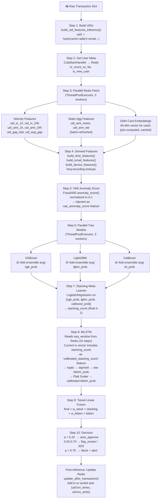

# Real-Time Inference Architecture — Fraud Detection

## Overview

A **5-stage sequential ensemble** where each stage feeds into the next. The final score is a weighted sum (not a simple vote) that adapts based on *how much history* exists for a user.

---

## The 10-Step Prediction Pipeline (`predict_single`)



---

## The Tiered Fusion (Cold Start Logic)

This is the **most important design decision** in the pipeline:

| User State | `tx_count` | `w_stack` | `w_bilstm` | Reason |
|---|---|---|---|---|
| **Cold** | < 3 | **0.80** | 0.20 | No sequence history → don't trust BiLSTM |
| **Warm** | 3–6 | 0.50 | 0.50 | Building history → blend equally |
| **Full** | > 6 | 0.20 | **0.80** | Rich history → trust sequence model |

> [!IMPORTANT]
> There is a **discrepancy** between `predict.py` and `cold_start.py`:
> - `predict.py` uses weights: **Cold=(0.8,0.2), Warm=(0.5,0.5), Full=(0.2,0.8)** and warm threshold at tx_count ≤ 6
> - `cold_start.py` defines: **TIER_COLD=(1.0,0.0), TIER_WARM=(0.8,0.2), TIER_FULL=(0.6,0.4)** and warm threshold at tx_count < 10
> 
> **`predict.py` is the live code** — the `ColdStartHandler.fuse_scores()` method is **never actually called** in predict_single(). The constants in `cold_start.py` are stale / unused.

---

## What Each Model Actually Does at Inference

### VAE (Variational Autoencoder)
- **Role**: Anomaly detector, NOT a classifier
- **Input**: Numerical features only (`vae_cols`)
- **Output**: Reconstruction error → normalized `vae_anomaly_score` (0→1)
- **How used**: Injected as a **feature** into XGB/LGBM/CatBoost — not fed into stacking directly
- The stacking docstring says it accepts `vae_anomaly_score` as input, but `STACKING_INPUT_COLS` is hardcoded to only `[xgb_prob, lgbm_prob, catboost_prob]`

### GNN (Graph Neural Network)
- **Role**: Card-level relationship encoding
- **What runs at inference**: **NOTHING** — GNN is pre-computed offline
- **Output**: 64-dim card embedding (loaded from `.npy` file, keyed by `card1`)
- **How used**: Embedding vector injected as features into XGB/LGBM/CatBoost
- Ring check (`fast_ring_check`) exists in `redis_atomic.py` but is **never called** in `predict_single()`

### XGBoost / LightGBM / CatBoost
- Each is a **K-fold cross-validated ensemble** (average of fold models)
- All use the same feature set (including `vae_anomaly_score` + GNN embedding dims)
- XGB uses explicit `xgb_feature_cols.csv` column list; LightGBM/CatBoost fall back to XGB's list

### Stacking Meta-Learner
- **Model**: `LogisticRegression(C=1.0)` with `StandardScaler`
- **Input**: Only `[xgb_prob, lgbm_prob, catboost_prob]` — 3 values
- **Output**: `stacking_score` — continuous probability [0, 1]
- **Intentionally NOT calibrated** here (isotonic calibration would bin values into steps, breaking the BiLSTM gradient signal)

### BiLSTM
- **Model**: `FraudBiLSTM` — bidirectional LSTM
- **Input**: Sequence of 10 timesteps × 13 features per step
- **Key feature**: `calibrated_stacking_score` is feature #13 at every timestep
- **Sequence source**: Redis LIST `user:{uid}:seq_window` (atomic Lua push+trim+read)
- **Cold-start padding**: Uses cohort-average priors (NOT zeros) to fill short windows
- **Output**: raw logit → sigmoid → `bilstm_prob` → **Platt Scaler** → calibrated prob

---

## Redis Data Layout

```
user:{uid}:features        → HASH   (tx_count, is_new_user, cohort priors)
user:{uid}:seq_window      → LIST   (last 10 serialized feature vectors as JSON)
uid:{uid}:txn_times        → ZSET   (timestamp → score for velocity window queries)
uid:{uid}:txn_amts         → ZSET   (timestamp:amount → score)
uid_stats:{uid}            → STRING (JSON: uid_amt_mean, uid_amt_std, etc.)
gnn:{card1}                → STRING (JSON: gnn_fraud_prob, ring_risk_score, node_embedding)
ring:device:{device_id}:uids → SET  (uid members for ring detection)
ring:email:{domain}:uids   → SET    (uid members for ring detection)
```

---

## Key Design Notes

### What's Actually Wired vs. What's Defined but Not Called
| Component | Defined? | Called in predict_single? |
|---|---|---|
| VAE anomaly score | ✅ | ✅ (as feature, not standalone prob) |
| GNN inference | ✅ | ❌ (only pre-computed embedding is used) |
| Ring check (`fast_ring_check`) | ✅ | ❌ never called |
| `ColdStartHandler.fuse_scores()` | ✅ | ❌ fusion done inline in predict.py |
| `ColdStartHandler.get_fusion_weights()` | ✅ | ❌ stale weights different from predict.py |
| BiLSTM Platt Scaler | ✅ | ✅ |
| `predict_batch()` | Referenced in run_inference.py | ❌ NOT implemented — falls back to row-by-row |

### Latency Budget
- Target: ~8ms per transaction
- Parallelized with `ThreadPoolExecutor` (Redis fetches: 3 parallel calls; tree models: 3 parallel calls)
- BiLSTM sequence window: 1 Lua round-trip (atomic push+trim+read)

### Train/Serve Skew Prevention
1. **Cohort padding** — BiLSTM padded with cohort-average priors (same values in train and Redis)
2. **Sort guarantee** — sequences sorted by `TransactionDT, TransactionID` in training (matches Redis RPUSH order)
3. **Stacking score in BiLSTM** — OOF predictions during training, live stacking score at inference
4. **Redis updated AFTER decision** — prevents future leakage into velocity features
